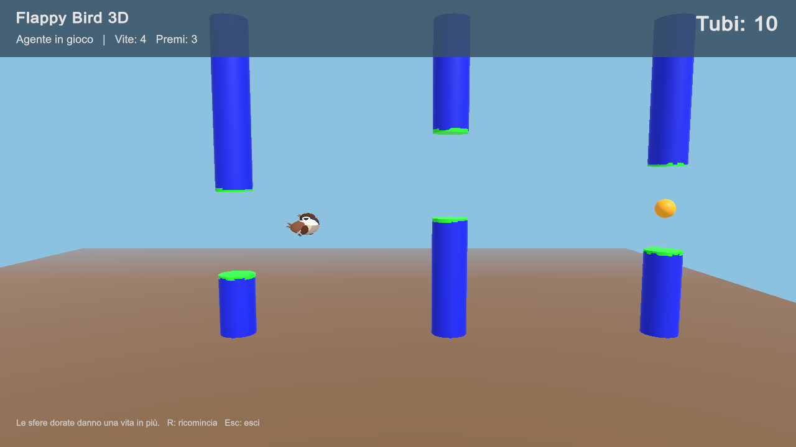

# Flappy Bird 3D

Flappy Bird 3D from Lab 3, extended for the optional Unity ML-Agents assignment.
The agent was trained with PPO to fly through the pipes and collect golden
orbs that grant extra lives.

[](consegna/FlappyBird3D-demo.mp4)

[35-second video](consegna/FlappyBird3D-demo.mp4) ·
[Report](report/Relazione-FlappyBird3D.md)

## Opening the project

The project uses **Unity 6000.6.2f1** and **ML-Agents 4.2.0**.
Clone the repository, add the folder in Unity Hub with
**Add > Add project from disk**, and open a scene in Assets/Scenes:

| Scene | Purpose |
|---|---|
| Inference.unity | Watch the trained agent |
| Lab3Tutorial.unity | Play using the arrow keys and Space |
| Training.unity | Train the agent in 24 parallel environments |

Press Play to start the scene. The arenas activate at startup.
The ONNX model is included in Assets/Models and runs in Unity without
starting the Python trainer.

## Game rules

Each run starts with one life. A golden orb appears every three pipe pairs
and grants one extra life. Each collision costs one life. If any lives remain,
the bird restarts while keeping its score. Collected prizes do not reappear
after a restart.

The manual game keeps the free movement used in Lab 3. In agent mode, flight
is restricted to a vertical plane and the bird has to pass through the gaps.
The network uses 11 observations about position, velocity, pipes and prizes
to decide whether to flap. Rewards and training experiments are described
in the report.

Sparrow and Pipe are the assets provided in the course. Imported materials
use the Standard shader, and the floor is plain brown.

## Results

The model reached 40 pipe pairs in all 30 evaluation runs, with no collisions
and an average of about 13 prizes per run. The random baseline reached
40 pipe pairs in none of its 30 runs. Individual results and plots are in report.

Evaluation uses base seed 13007 and a limit of 120 simulated seconds.
The 40-pair limit is only for evaluation: the normal game continues as long
as lives remain.

## Repeating the training

With a Python 3.10.12 environment active:

```bash
python -m pip install -r requirements.txt
```

In Unity, use **Flappy Lab > Prepare tutorial and training** to build the
training app for Mac. Then run these commands from the project folder:

```bash
python scripts/prepare_transfer.py
python scripts/train.py --run-id flappy3d-replica
```

The v6 checkpoint needed for the transfer is included. The first script prepares
the 11-observation network; the second trains it with config/flappy-prizes.yaml.
To resume an interrupted run, add --resume and use the same run ID.
**Flappy Lab > Build trained game** rebuilds the game with the updated model.

To repeat the checks after building the Mac apps:

```bash
python scripts/verify_game.py mechanics
python scripts/verify_game.py random
python scripts/verify_game.py trained
```

The repository contains the source project, model, configurations, results and
video. Unity recreates its cache folders, and builds are kept locally.
