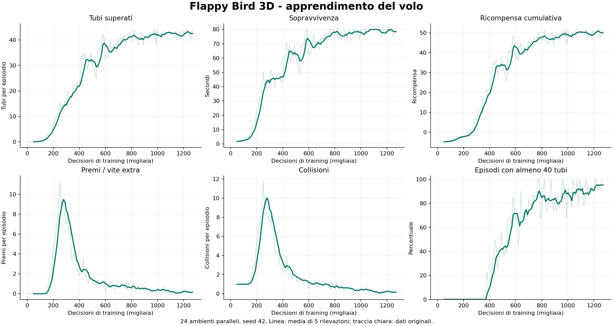
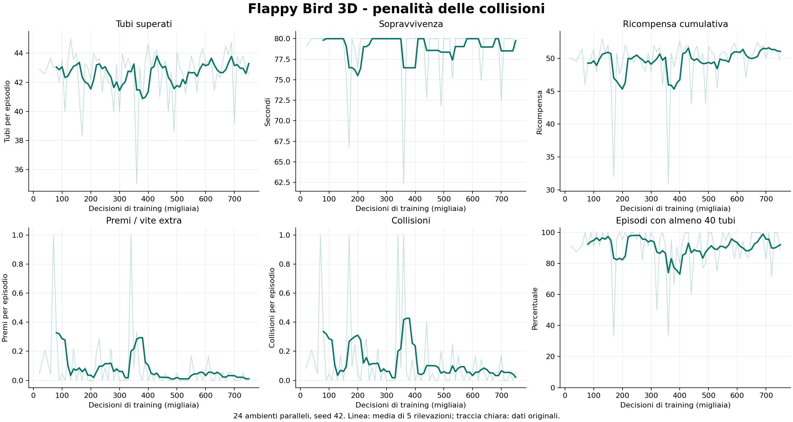
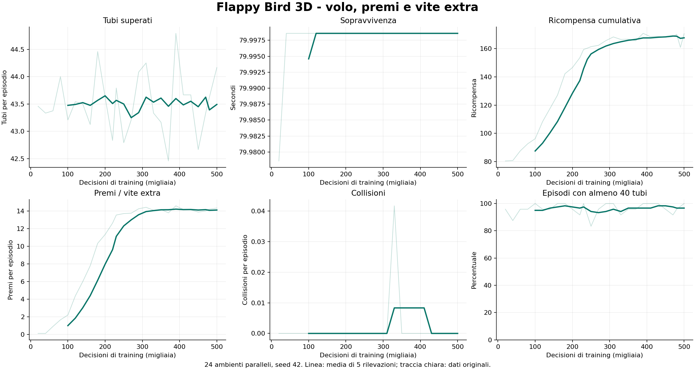

# Flappy Bird 3D con ML-Agents

Il gioco riprende il Flappy Bird 3D del Lab 3 e lo estende con l'agente richiesto
dal facoltativo del Lab 6. Usa Sparrow_LOD0, con scala (6, 3, 5), e i tubi di
Pipe-2.unitypackage. Gli asset sono quelli forniti nel corso.

## Gioco e agente

Il movimento usa il Character Controller, la gravità e il battito in aria
del tutorial. La camera segue il passerotto in LateUpdate. Sono stati aggiunti
generazione dei tubi, punteggio, premi e gestione delle vite.

Lab3Tutorial mantiene i comandi manuali. In Training e Inference il volo è
vincolato al piano verticale, per evitare che l'agente aggiri i tubi in profondità.
I collisori arrivano al pavimento e un controllo aggiuntivo evita che il
Character Controller attraversi un ostacolo per effetto delle compenetrazioni.
I materiali importati usano lo shader Standard; il pavimento è marrone uniforme.

La partita inizia con una vita. Ogni tre coppie di tubi compare una sfera dorata
che aggiunge una vita quando viene raccolta. Una collisione ne consuma una:
se ne restano, il volo riparte conservando il punteggio. Un premio già raccolto
non ricompare alla ripartenza. Il punto viene assegnato una volta sola, dopo
l'ingresso nel trigger Middle Pipe e il completo attraversamento del varco.

L'agente usa 11 osservazioni: quota e velocità verticale; distanza e dislivello
del prossimo varco; dimensione del varco; distanza e dislivello del secondo;
distanza, dislivello e presenza del prossimo premio; velocità dei tubi.
L'azione è discreta e ha due valori: battere le ali oppure aspettare.

## Allenamento

Il modello finale usa PPO con seed 42 e 24 ambienti paralleli. La rete ha due
strati da 128 unità e normalizza le osservazioni. I parametri principali sono
learning rate iniziale 0,0003, gamma 0,99, batch 1024 e buffer 8192.
L'agente decide ogni 5 passi fisici; un episodio dura al massimo 4000 passi,
cioè 80 secondi simulati. L'ultima rilevazione è a 500.000 decisioni.

| Evento | Ricompensa |
|---|---:|
| Tubo superato | +1 |
| Premio raccolto | +5 |
| Decisione in cui l'agente resta vivo | +0,01 |
| Collisione | -10 |
| Perdita dell'ultima vita | ulteriori -3 |

Per facilitare la raccolta è stato aggiunto un incentivo all'allineamento.
Quando il prossimo varco contiene un premio e dista meno di 18 unità,
ogni decisione riceve `0,3 * exp(-errore_verticale² / 4)`.
I valori delle ricompense, il numero di vite iniziali e la frequenza dei premi
sono scelte del progetto; la consegna lascia aperti questi dettagli.

Le prime prove avevano imparato ad attraversare i tubi, ma raccoglievano pochi
premi. Il checkpoint del volo a circa 750.000 passi raggiungeva 40 tubi in tutte
le 30 partite valutate, con un solo premio raccolto complessivamente.
Sono poi state modificate le ricompense e le osservazioni.

| Fase | Osservazioni | Modifica principale |
|---|---:|---|
| flappy3d-ppo-v2 | 12 | Apprendimento del volo; premio +0,5, collisione -2; arresto a circa 1,27 milioni di decisioni |
| flappy3d-final-v5 | 12 | Premio +5 e collisione -10; 750.000 decisioni |
| flappy3d-final-v6 | 12 | Allineamento +0,05 e partenze con 1-3 vite nel training; 500.000 decisioni |
| flappy3d-final-v7 | 11 | Rimozione delle vite dalle osservazioni e allineamento +0,3; modello finale |

Nelle prove con 12 osservazioni il controllo peggiorava dopo la raccolta di
un premio. L'osservazione delle vite è stata quindi rimossa dalla rete finale.
Per conservare il volo già appreso, scripts/prepare_transfer.py trasferisce
attore e critico da v6: incorpora nel bias del primo strato il contributo
corrispondente a una vita, poi rimuove la colonna e la statistica di
normalizzazione associate. PPO riprende l'allenamento dalla rete così ottenuta.

Il trasferimento è stato verificato su 10.000 vettori:
le azioni deterministiche coincidono prima e dopo la modifica. L'errore massimo
nelle attivazioni è 4.8e-06 per l'attore e
3.3e-06 per il critico.
I parametri delle fasi intermedie sono conservati nei file in config.

Tre prove sono state scartate: diagnostic-v1-rail-test permetteva spostamenti
laterali; diagnostic-v3-prize-respawn faceva ricomparire premi già raccolti;
flappy3d-final-v4 raggiungeva 40 tubi perdendo una vita dopo ogni premio.
Le correzioni impediscono la raccolta ripetuta e penalizzano maggiormente le
collisioni. Le ricompense cumulative di fasi diverse non sono confrontabili
direttamente, perché sono cambiate anche le regole di assegnazione.

## Risultati

La valutazione esegue il modello ONNX in Unity senza il trainer Python.
Comprende 30 partite con seed base 13007, separato dai seed usati
nello sviluppo (base 2026). Ogni partita parte con una vita e si ferma a
40 tubi o dopo 120 secondi simulati. Il confronto casuale sceglie di battere
le ali con probabilità 0,2 a ogni decisione.

| Misura | Controllo casuale | Agente addestrato |
|---|---:|---:|
| Partite che raggiungono 40 tubi | 0/30 | 30/30 |
| 40 tubi senza collisioni | 0/30 | 30/30 |
| Tubi per partita, media | 0,17 | 40,00 |
| Durata simulata, secondi medi | 2,29 | 73,43 |
| Premi per partita, media | 0,00 | 12,97 |
| Collisioni per partita, media | 1,00 | 0,00 |

Il risultato riguarda questa replica di training e queste 30 partite.
Le singole prove sono nei file evaluation_random.json ed evaluation_trained.json;
i CSV riportano le metriche di TensorBoard. Il limite di 40 tubi serve al test:
nel gioco normale la partita continua finché restano vite.

I controlli sulle meccaniche sono passati: vita extra, raccolta unica anche dopo
una ripartenza, punteggio assegnato una volta sola, perdita delle vite e reset
dopo il Game Over. Il video dura 35 secondi (1280 x 720, 30 fps, seed 2026)
e mostra 18 tubi superati, 6 premi e 0 collisioni.

Modello usato, SHA-256: `1442ed0aba1df28e0cb79cc06d04a925846b078a2ef93ce4a07be5ff708a24ba`.

## File

Il TXT descrittivo, il video e lo ZIP sono in consegna. Nel TXT vanno inseriti
i link al progetto e al video dopo il caricamento su Drive/OneDrive o repository.
